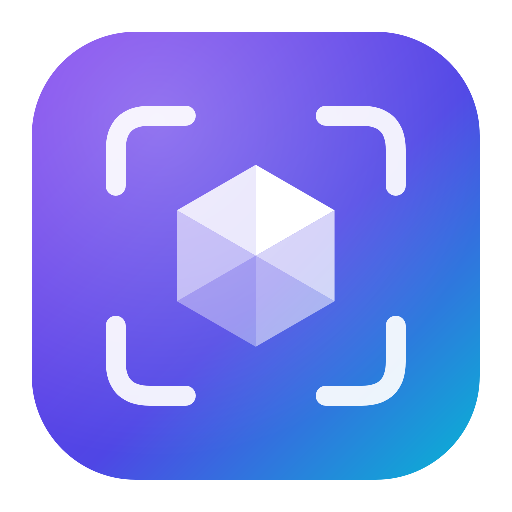
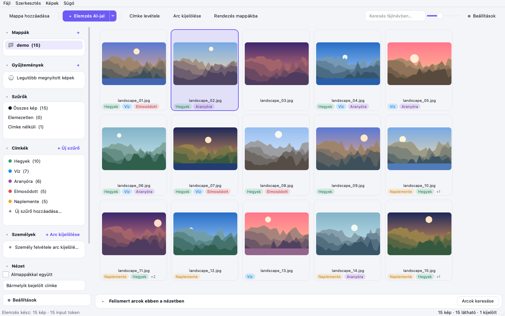

<p align="center">
  
</p>

<h1 align="center">Facet</h1>

<p align="center">
  <b>AI-alapú fotóválogatás és -rendezés fotósoknak – címkék, személyek és mappák pár kattintással.</b><br>
  Natív asztali alkalmazás macOS-re és Windowsra · AI: <a href="https://docs.typesafe.ai/introduction">TypeSafe JEV</a> vagy <a href="https://developers.openai.com/api/docs/guides/images-vision">OpenAI (ChatGPT)</a>
</p>

<p align="center"><i><a href="README.md">English</a></i></p>

<p align="center">
  
</p>

---

## Mit tud?

Megadsz egy mappát (esküvő, nyaralás, fotózás). A Facet gyors rácsban mutatja az összes képet. Az AI minden képet
végignéz a **saját címkéid** szerint („elmosódott”, „csukott szem”, „a pár csókolózik”…), és **felismeri a képeken
szereplő embereket**. Utána szűrsz, nagyítasz, javítasz, és mappákba rendezed a képeket.

| | |
|---|---|
| 🏷 **Címkék** | Öt **beépített címke** mindig, minden mappában ott van: *Elmosódott, Mosolyog valaki, Csukott szem, Túlexponált, Alulexponált*. A **saját címkéid** (**+ Új szűrő**) ahhoz a mappához tartoznak, ahol létrehoztad őket, így egy esküvő „Csók” címkéje nem jelenik meg a nyaralós képeknél. Minden címke egy igen/nem kérdés az AI-nak; a küszöb utólag, élő előnézettel állítható („12 / 92 kép · legmagasabb pontszám 81%”), újraelemzés nélkül. |
| 🤖 **Választható AI** | **TypeSafe JEV** (kalibrált igen/nem valószínűségek, személyeket is keres az arcuk alapján) vagy **OpenAI / ChatGPT** képfelismerő modellek (alapból `gpt-5.4-mini`). A Beállításokban váltható; mindkettő képenként egy API-hívás. |
| 👤 **Személyek** | Opcionális: az **Arcok keresése** gombbal a Facet **a gépeden** megkeresi és csoportosítja az arcokat. Egy csoportot elnevezel, és onnantól az új képeken is felismeri az illetőt. ⚠ Az arcfelismerés nem 100%-os – ellenőrizd a csoportokat. Oldalnézethez és kis arcokhoz a JEV is kereshet a referenciaarcokkal. |
| 🔎 **Szűrés és kijelölés** | Címkék és személyek bevonása (✓) vagy kizárása (✕), bármelyik/mindegyik feltétel, elemezetlen, címke nélküli, csak RAW, fájlnév. A találatos címkék vannak felül, és bármely címke valószínűsége szerint rendezhetsz. |
| 📁 **Rendezés mappákba** | Címkénként vagy személyenként külön almappába, vagy mind egy mappába. Másolhatsz vagy áthelyezhetsz, a kísérő fájlok (`.xmp`, `.aae`, RAW+JPEG pár) is mennek. Minden művelet visszavonható; visszavonáskor a másolatok a Kukába kerülnek. |
| 🖼 **Nézegető** | Teljes képernyős nézegető zoommal (görgő, csíptetés, 100%), nyilas lapozással, címkekapcsolókkal és arckijelöléssel. A RAW a beágyazott előnézettel nyílik meg, nagyításkor teljes minőségben hívja elő. |
| 📚 **Könyvtár** | A mappák és a gyűjtemények (több mappán átívelő virtuális albumok) a Lightroomhoz hasonlóan az oldalsávon maradnak, a *Legutóbb megnyitott képekkel* együtt. Az oldalsáv minden része összecsukható, és az egész sáv egyben görgethető. |
| 🌗 **Modern felület** | Lekerekített, letisztult megjelenés világos és sötét módban (a rendszer szerint), magyarul és angolul. |

## Indítás

```bash
git clone https://github.com/CeelNok/facet-photo.git
```

### macOS
1. Klónozd a tárolót (fent), vagy töltsd le ZIP-ként (**Code → Download ZIP**).
2. Kattints duplán a projektmappában a **`Facet.app`**-ra (a Facet logós ikonra).
   Az első indításkor saját Python-környezetet állít be, ez kb. 1–2 perc.
   - Python 3.10+ kell ([python.org](https://www.python.org/downloads/) vagy Homebrew), vagy a [uv](https://docs.astral.sh/uv/).
   - Ha ZIP-ként töltötted le, és a macOS letiltja („ismeretlen fejlesztő”): **Rendszerbeállítások →
     Adatvédelem és biztonság → Megnyitás mindenképp** (egyszer kell). `git clone` esetén ez nem jelentkezik.

### Windows
1. Telepítsd a [Python 3.10+](https://www.python.org/downloads/) verziót, és pipáld be: **„Add python.exe to PATH”**.
2. Kattints duplán a **`Facet.bat`**-ra. Az első indítás mindent telepít, és létrehoz egy logós **Facet**
   parancsikont a mappában. Ezt kitűzheted a Startra vagy a tálcára.

### AI-szolgáltató és API kulcs
**⚙ Beállítások → Elemzéshez használt AI**: válaszd ki a szolgáltatót, add meg a kulcsát, majd **Kapcsolat
tesztelése**.

| Szolgáltató | Kulcs | Alapmodell | Megjegyzés |
|---|---|---|---|
| TypeSafe JEV | <https://console.typesafe.ai/keys> | `jev-latest` | Kalibrált valószínűségek; személyeket is keres a referenciaarcaik alapján. A képkezelés a TypeSafe-nél béta. |
| OpenAI (ChatGPT) | <https://platform.openai.com/api-keys> | `gpt-5.4-mini` | Responses API szigorú JSON-sémával, `store: false` beállítással. Az OpenAI modellek nem hasonlítanak össze arcokat, így a személyeket csak a helyi arcfelismerés találja meg. Más modellek: `gpt-5.4-nano` (legolcsóbb), `gpt-5.4`, `gpt-5.5` (legpontosabb). |

A kulcsok a Facet adatmappájában, csak számodra olvasható fájlokban tárolódnak (`api_key`, `openai_api_key`). A Facet
nem használja a rendszer kulcstartóját, ezért soha nem kér jelszót. Szolgáltatóváltáskor a meglévő eredmények
megmaradnak; az *Újraelemzés* a másik AI-jal futtatja le újra a képeket.

## Jó címkék írása

- **Angol kérdés, a képre `` `photo` `` néven hivatkozva.** Ha sima leírást írsz (bármilyen nyelven), a Facet
  „Does `photo` match this description?” kérdéssé alakítja, de a közvetlen angol kérdés pontosabb.
  Példa: *Are the bride and groom kissing in `photo`?*
- **Címkénként egy dolog.** A „szép esküvői kép” helyett: *csók*, *mosolyog*, *csukott szem*.
- **Állítsd be a küszöböt.** Jobb klikk a címkén → *Szerkesztés…* megmutatja, hány kép felel meg az adott
  küszöbbel, és mekkora a legmagasabb pontszám.

## Személyek

- **Arcok keresése (opcionális):** a rács alatti **Arcok keresése** gombbal a Facet megkeresi az arcokat, és
  csoportosítja az azonos személyeket. A csoportok kerek kis képekként jelennek meg a **Felismert arcok** sávban.
  Kattintásra az illető képei látszanak, dupla kattintással elnevezheted. Az automatikus keresés mappanyitáskor a
  Beállításokban kapcsolható be.
- ⚠ **Nem 100%-os:** kimaradhat valaki, két ember összekeveredhet, vagy egy ember több csoportba kerülhet. Mielőtt
  személy szerint rendezed a képeket, ellenőrizd a csoportokat.
- **Kézzel:** a nézegetőben **F**, keret az arc köré, majd név.
- **Oldalnézet, kis arcok:** jobb klikk a személyen → *Keresés AI-jal is*. A TypeSafe JEV a referenciaarcokkal azokon
  a képeken keres, ahol a helyi felismerés nem talált (JEV kulcs kell hozzá, akkor is, ha az OpenAI a fő szolgáltató).
- A helyi felismerés (OpenCV YuNet + SFace) ingyenes, semmit nem tölt fel, egy CPU-szálon fut, és a Beállításokban
  kikapcsolható.

## Billentyűk

| Billentyű | Rács | Nézegető |
|---|---|---|
| `Szóköz` / `Enter` / dupla katt | nézegető megnyitása | bezárás |
| `1` – `9` | 1–9. címke ki/be a kijelölésen | 1–9. címke ki/be |
| `Backspace` | minden címke levétele (rákérdez) | minden címke levétele |
| `← →` | – | előző / következő |
| `Z` / dupla katt | – | 100% ↔ illesztés |
| `F` | – | arc kijelölése |
| `Cmd/Ctrl + A` / `E` / `M` / `Z` | mind kijelölése / elemzés / rendezés / visszavonás | – |

## Adatvédelem, energia, memória

- **Helyben maradnak a képek:** csak AI-elemzéskor megy ki egy kicsinyített JPEG (alapból 1024 px) a választott
  szolgáltatónak. Az arcfelismerés soha nem hagyja el a gépet.
- **Takarékos működés:** üresjáratban ~0% CPU. Csak a látható képek töltődnek be. A JPEG DCT-skálázással
  dekódolódik, a RAW-hoz a beágyazott előnézetet használja.
- **Kötött memória:** a memóriában lévő bélyegkép-gyorsítótár legfeljebb ~96 MB, a nézegető egyszerre legfeljebb
  két képet tart a memóriában.

## Önálló alkalmazás készítése

```bash
./build_mac.sh          # → dist/Facet.app
build_windows.bat       # → dist\Facet\Facet.exe (Windowson)
```

## Harmadik féltől származó összetevők

Lásd: [THIRD_PARTY_NOTICES.md](THIRD_PARTY_NOTICES.md).

## Licenc

A Facet az [MIT licenc](LICENSE) alatt érhető el. A harmadik féltől származó összetevők a saját licencük alá
tartoznak (lásd: [THIRD_PARTY_NOTICES.md](THIRD_PARTY_NOTICES.md)).
