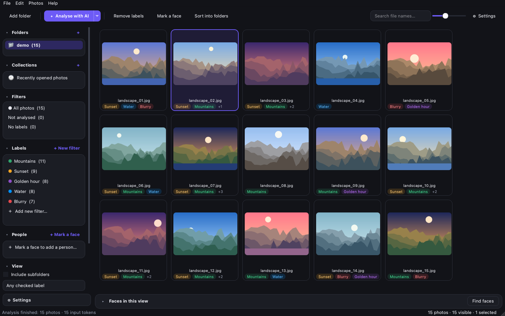

<p align="center">
  
</p>

<h1 align="center">Facet</h1>

<p align="center">
  <b>AI photo culling & sorting for photographers – labels, people and folders in a few clicks.</b><br>
  Native desktop app for macOS and Windows · AI by <a href="https://docs.typesafe.ai/introduction">TypeSafe Jev</a> or <a href="https://developers.openai.com/api/docs/guides/images-vision">OpenAI (ChatGPT)</a>
</p>

<p align="center">
  
  
  
  
  
  
</p>

<p align="center"><i><a href="README.hu.md">Magyar leírás</a></i></p>

<p align="center">
  
</p>

---

## What it does

You point Facet at a folder (a wedding, a holiday, a shoot). Facet shows every photo in a fast grid, an AI model
checks each one against **your own labels** ("blurry", "eyes closed", "the couple kissing"…), and it
**recognises the people** in your photos. Then you filter, zoom, fix and sort everything into folders.

| | |
|---|---|
| 🏷 **Labels** | Five **built-in labels** are always there, in every folder: *Blurry, Smiling, Eyes closed, Overexposed, Underexposed*. Your **own labels** (**+ New filter**) belong to the folder you create them in, so a wedding's "Kiss" label does not show up in your holiday photos. Every label is a yes/no question for the AI; its threshold can be tuned later with a live preview ("12 of 92 photos · highest score 81%") without re-analysing. |
| 🤖 **Choose your AI** | **TypeSafe Jev** (calibrated yes/no probabilities, can also look for people by their faces) or **OpenAI / ChatGPT** vision models (`gpt-5.4-mini` by default). Switch in Settings – one API call per photo either way. |
| 👤 **People** | Optional: press **Find faces** and Facet finds and groups faces **on your computer**. Give a group a name and Facet recognises that person on new photos too. ⚠ Face recognition is not 100% accurate – check the groups. For side views and small faces Jev can also search with the reference faces. |
| 🔎 **Filter & select** | Include (✓) or exclude (✕) labels and people, any/all matching, not analysed, no labels, RAW only, file names. Labels with matches come first; you can also sort by any label's probability. |
| 📁 **Sort into folders** | One subfolder per label or person, or everything into one folder. Copy or move, with companion files (`.xmp`, `.aae`, RAW+JPEG pairs). Every operation can be undone; undone copies go to the Trash. |
| 🖼 **Viewer** | Full-screen viewer with zoom (scroll, pinch, 100 %), arrow-key browsing, label toggles and face marking. RAW files open from their embedded preview and are developed at full quality when you zoom in. |
| 📚 **Library** | Folders and collections (virtual albums across folders) stay in the sidebar, like in Lightroom, together with *Recently opened photos*. Every sidebar section can be folded; the whole sidebar scrolls as one. |
| 🌗 **Modern UI** | Rounded, clean interface in light and dark mode (follows the system), English and Hungarian. |

## Getting started

```bash
git clone https://github.com/CeelNok/facet-photo.git
```

### macOS
1. Clone the repository (above) or download it as a ZIP (**Code → Download ZIP**).
2. Double-click **`Facet.app`** in the project folder (the one with the Facet logo).
   The first start sets up a private Python environment and takes about 1–2 minutes.
   - Requires Python 3.10+ ([python.org](https://www.python.org/downloads/) or Homebrew) or [uv](https://docs.astral.sh/uv/).
   - If you downloaded the ZIP and macOS blocks the app ("unidentified developer"), open
     **System Settings → Privacy & Security** and click **Open Anyway** (once). A `git clone` is not affected.

### Windows
1. Install [Python 3.10+](https://www.python.org/downloads/) and tick **“Add python.exe to PATH”**.
2. Double-click **`Facet.bat`**. The first start installs everything and creates a **Facet** shortcut with the
   logo in the project folder. Pin that shortcut to Start or the taskbar.

### From a terminal
```bash
git clone https://github.com/CeelNok/facet-photo.git && cd facet-photo
python3 -m venv .venv
.venv/bin/pip install -r requirements.txt     # Windows: .venv\Scripts\pip install -r requirements.txt
.venv/bin/python run.py                        # optional: run.py /path/to/photos
```

### AI provider and API key
Open **⚙ Settings**, choose **AI for analysis** and enter the key of that provider, then press **Test connection**:

| Provider | Get a key | Default model | Notes |
|---|---|---|---|
| TypeSafe Jev | <https://console.typesafe.ai/keys> | `jev-latest` | Calibrated probabilities; can search for people by their reference faces. Images are a beta (“Dreamer-ready”) feature at TypeSafe. |
| OpenAI (ChatGPT) | <https://platform.openai.com/api-keys> | `gpt-5.4-mini` | Uses the [Responses API](https://developers.openai.com/api/docs/guides/images-vision) with a strict [JSON schema](https://developers.openai.com/api/docs/guides/structured-outputs); requests are sent with `store: false`. OpenAI models do not compare faces, so people come from local recognition only. Other choices: `gpt-5.4-nano` (cheapest), `gpt-5.4`, `gpt-5.5` (most accurate). |

Keys are stored in private files (`api_key`, `openai_api_key`, readable only by your user account) in Facet's data
folder. Facet never uses the system keychain, so it never asks for a password. Results already computed stay when
you switch provider; use *Re-analyse* to redo photos with the other AI.

## Writing good labels

Built-in labels (always present, names follow the UI language, cannot be deleted – only the threshold and colour
change): **Blurry, Smiling, Eyes closed, Overexposed, Underexposed**. Labels you add apply only to the folder
(and its subfolders) where you created them; people apply to the whole library.

The AI answers a yes/no question per label and returns a probability. A few rules give much better results:

- **Ask in English and refer to the image as `` `photo` ``.** If you write a plain description (in any language),
  Facet turns it into "Does `photo` match this description?", but a direct English question is still more precise.
- **One clear thing per label.** Split "nice wedding photo" into *bride and groom kissing*, *smiling*, *eyes closed*.
- **Tune the threshold.** Right-click a label → *Edit…* shows how many photos match at each threshold and the
  highest score, so you can pick a sensible cut-off.

| Label | Question |
|---|---|
| Kiss | Are the bride and groom kissing in `photo`? |
| First dance | Is a couple dancing on a dance floor in `photo`? |
| Group photo | Is `photo` a group photo with three or more people? |

## People

- **Find faces (optional):** press **Find faces** under the grid. Facet detects faces and groups the same person.
  The groups appear as round thumbnails in **Faces in this view**. Click one to see that person's photos.
  Double-click to give it a name. Automatic scanning when a folder opens can be switched on in Settings.
- ⚠ **Not 100% accurate:** people can be missed, two people can be mixed up, or one person can be split into
  several groups. Check the groups before sorting photos by person.
- **Manual:** in the viewer press **F**, drag a box around a face and type a name.
- **Side views & small faces:** right-click a person → *Also search with AI*. TypeSafe Jev compares the person's
  reference faces with the photos where local recognition found nothing (needs a Jev key, also when OpenAI is the
  main provider).
- Local recognition uses OpenCV's YuNet and SFace models. It is free, nothing is uploaded, it runs on one CPU
  thread, and the models are unloaded after a scan.

## Keyboard shortcuts

| Key | Grid | Viewer |
|---|---|---|
| `Space` / `Enter` / double-click | open viewer | close |
| `1` – `9` | toggle label 1–9 on selection | toggle label 1–9 |
| `Backspace` | remove all labels (asks first) | remove all labels |
| `← →` | – | previous / next |
| `Z` / double-click | – | 100 % ↔ fit |
| `F` | – | mark a face |
| `Cmd/Ctrl + A` | select all visible | – |
| `Cmd/Ctrl + E` | analyse selection | – |
| `Cmd/Ctrl + M` | sort into folders | – |
| `Cmd/Ctrl + Z` | undo sorting | – |

## Privacy, energy and memory

- **Photos stay local** unless you start an AI analysis. Even then only a downscaled JPEG (1024 px by default) is
  sent to the provider you chose. Face recognition never leaves your computer.
- **Native Qt app.** It uses ~0 % CPU when idle: there are no timers or file watchers, and worker threads sleep.
- **Virtualised grid:** only on-screen photos are decoded. JPEGs are decoded at 1/2–1/8 size for thumbnails
  (≈3 ms for 24 MP), and RAW files use the embedded preview (≈35 ms).
- **Bounded memory:** the thumbnail cache is capped at ~96 MB in RAM plus a disk cache. The viewer keeps at most
  two images in memory.

## Building a standalone app

```bash
./build_mac.sh          # → dist/Facet.app (includes Python and all libraries)
build_windows.bat       # → dist\Facet\Facet.exe (run on Windows)
```

## Where data is stored

| | macOS | Windows |
|---|---|---|
| Labels, people, results, library | `~/Library/Application Support/Facet/Facet/` | `%APPDATA%\Facet\Facet\` |
| Thumbnail cache | `~/Library/Caches/Facet/Facet/` | `%LOCALAPPDATA%\Facet\Facet\cache\` |

Facet writes into your photo folders only when you sort photos.

## Project structure

```
Facet.app/            macOS launcher (logo + name, signed stub → Contents/Resources/launch.sh)
Facet.bat             Windows launcher, creates a Facet shortcut with the logo
run.py                entry point
facet/
  app.py              start-up: language, theme, migration, --self-test
  mainwindow.py       main window: library, filters, people, analysis, sorting
  sidebar.py          collapsible sidebar sections in one scrollable column
  grid.py             virtualised thumbnail grid
  viewer.py           viewer: progressive loading, zoom, face marking
  faces.py            local face detection, recognition and grouping
  facespanel.py       “Faces in this view” strip
  analyzer.py         parallel AI analysis
  ai.py               provider layer (Jev / OpenAI), retries, errors
  jev_client.py       TypeSafe System One HTTP client (multipart)
  openai_client.py    OpenAI Responses API client (vision + strict JSON schema)
  imaging.py          JPEG DCT scaling, RAW, HEIC, AI image prep, face crops
  thumbs.py           thumbnail threads, disk + memory cache
  organizer.py        copy / move, companion files, undo
  storage.py          settings, labels, SQLite, API key file
  dialogs.py          labels, people, settings, sorting dialogs
  theme.py            light / dark theme
  i18n.py, lang_hu.py translations
  assets/             logo (SVG/PNG/ICNS/ICO) and face models
tools/                launcher.c + make_launcher.sh (rebuild and sign Facet.app)
docs/                 screenshots
```

## Third-party components

See [THIRD_PARTY_NOTICES.md](THIRD_PARTY_NOTICES.md).

## License

Facet is released under the [MIT License](LICENSE). Third-party components keep their own licences
(see [THIRD_PARTY_NOTICES.md](THIRD_PARTY_NOTICES.md)).
